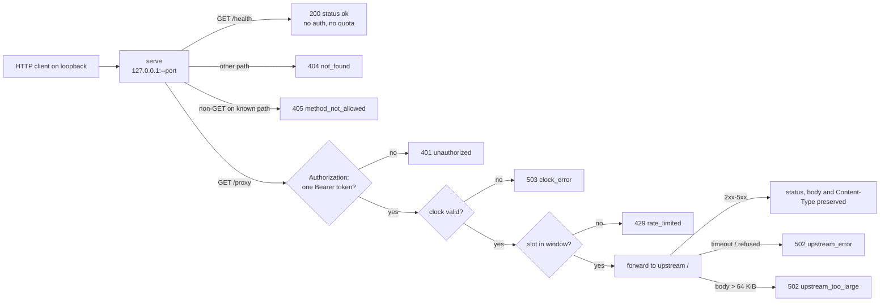

# loopback-gateway

A small, local HTTP gateway with a static bearer token and a fixed-window rate
limit. It listens only on `127.0.0.1`, proxies `GET /proxy` to a loopback
upstream, and keeps its quota in memory.

This is an educational subset of the original "API Gateway with Rate Limiting
and Auth" idea (issue #13): no JWT, no TLS, no public DNS, no dashboard and no
deployment. It targets **spec 0.1.4** and ships as **product 0.1.0**.

## What it does

- `GET /health` → `200 {"status":"ok"}` without authentication or quota.
- `GET /proxy` → requires exactly one `Authorization: Bearer TOKEN` header,
  consumes one slot in the current fixed window, then forwards to
  `http://127.0.0.1:UPSTREAM_PORT/` with the same query string.
- Every other path → `404 not_found`; any non-GET method on a known path →
  `405 method_not_allowed` (including `HEAD`).
- Missing, duplicated or wrong credentials → `401 unauthorized`.
- Too many requests in the window → `429 rate_limited`.
- Upstream timeout or connection failure → `502 upstream_error`; an upstream
  body larger than 65536 bytes → `502 upstream_too_large`.



## Platform

- Declared targets: **Ubuntu** and **macOS**, Python **3.12**.
- CI runs on `ubuntu-latest` and `macos-latest` with `PYTHONUTF8=1`.
- Native Windows is out of scope for this version.
- Runtime standard library only; there is nothing to install to run the gateway.

## Usage examples

Requires Python 3.12, curl and a POSIX shell. Run all steps from the repository
root in the same shell, with ports **9000 and 8080 free**. New checked-in
fixtures are `fixtures/config.json` and `fixtures/www/index.html`.
`demo-token` is a public demo value, never a production credential.
Startup waits for the upstream, then for the gateway health endpoint; logs
go to `upstream.log` and `gateway.log`. The unauthenticated request is
HTTP 401; curl `-f` suppresses the response body and exits 22. The final
step stops and reaps both servers (wait returns 143 after SIGTERM).

```console
$ python -m http.server 9000 --bind 127.0.0.1 --directory fixtures/www > upstream.log 2>&1 & upstream_pid=$!; until curl -fsS http://127.0.0.1:9000/ -o /dev/null 2>/dev/null; do sleep 0.1; done
$ python serve --config fixtures/config.json --port 8080 > gateway.log 2>&1 & gateway_pid=$!; until curl -fsS http://127.0.0.1:8080/health -o /dev/null 2>/dev/null; do sleep 0.1; done; cat gateway.log
{"port":8080}
$ curl -fsS -H 'Authorization: Bearer demo-token' http://127.0.0.1:8080/proxy
hello
$ curl -fsS http://127.0.0.1:8080/proxy
curl: (22) The requested URL returned error: 401
$ echo $?
22
$ kill "$gateway_pid" "$upstream_pid"; wait "$gateway_pid" "$upstream_pid" 2>/dev/null
```

## CLI

```text
usage: serve --config CONFIG --port PORT [--clock-file FILE]
       serve --help
       serve --version
```

| Option | Meaning |
| --- | --- |
| `--config CONFIG` | Required. Path to the JSON configuration file. |
| `--port PORT` | Required. ASCII digits, `0..65535`. `0` binds an ephemeral port. |
| `--clock-file FILE` | Optional. Test clock: ASCII integer milliseconds read on each request. |
| `--help` | Print help and exit 0. |
| `--version` | Print `loopback-gateway 0.1.0` and exit 0. |

Exit codes: `0` success, `1` failed bind, `2` invalid arguments or invalid
configuration, `3` unreadable configuration. CLI errors print one `error:` line
to stderr with empty stdout.

### Configuration

```json
{"upstream_port":9000,"token":"demo-token","limit":2,"window_ms":1000}
```

The object must contain **exactly** these four fields:

| Field | Type | Range |
| --- | --- | --- |
| `upstream_port` | strict integer | `1..65535` |
| `token` | string | `[A-Za-z0-9_-]{8,64}` |
| `limit` | strict integer | `1..1000` |
| `window_ms` | strict integer | `1..60000` |

Booleans are not integers, `2.0` is not an integer, duplicate keys and
`NaN`/`Infinity` are rejected, and a UTF-8 BOM is invalid. Invalid
configuration prevents startup with exit 2.

## HTTP API

| Request | Result |
| --- | --- |
| `GET /health` (query allowed) | `200` with `{"status":"ok"}\n`; no auth, no clock, no quota. |
| `GET /proxy` (query allowed) | Auth, clock, quota, then forward to upstream `/` with the same query. |
| Unknown path, e.g. `/proxy/`, `/Health/extra` | `404 {"error":"not_found"}`. |
| Non-GET on `/health` or `/proxy` | `405 {"error":"method_not_allowed"}`; `HEAD` has an empty body. |
| Bad or absent `Authorization` | `401 {"error":"unauthorized"}`. |
| Invalid/regressing/unreadable clock | `503 {"error":"clock_error"}`. |
| Quota exhausted | `429 {"error":"rate_limited"}`. |
| Upstream timeout or refused connection | `502 {"error":"upstream_error"}`. |
| Upstream body over 65536 bytes | `502 {"error":"upstream_too_large"}`. |

Forwarded responses preserve the upstream status (`200..599`), body bytes and
`Content-Type` (default `application/octet-stream`). Other upstream headers are
discarded, `Location` is never exposed, and redirects are not followed. The
`Authorization` header is not forwarded upstream. Local JSON bodies are one line
plus `\n`, and upstream bytes are forwarded unchanged (no added newline).

### Rate limiting and the test clock

The quota is a single per-process counter keyed by
`floor(now_ms / window_ms)`. Auth is checked first, then the clock, then one
slot is reserved atomically before forwarding. A slot is consumed even if the
upstream later times out. `404`, `405`, `401` and clock errors consume nothing,
and `GET /health` never touches the quota.

By default the gateway uses a real monotonic clock. `--clock-file` replaces it
with an ASCII integer file (optional single trailing LF) read on every
`/proxy` request; values outside `0..2^53-1`, malformed content, a missing file
or a value below the previous accepted value yield `503 clock_error`.

## Limits

- Loopback only, a single static token, one process, one quota key.
- No persistence: restarting clears the quota; only the config and clock files
  are read from disk.
- 1-second upstream timeout and a 64 KiB (65536-byte) response cap.
- No retries, no TLS, no JWT, no dashboard, no deployment.
- Not a production gateway.

## Development

There are no runtime dependencies: `pyproject.toml` is the runtime manifest
(`requires-python >= 3.12`, empty `dependencies`), so there is no setup step and
`./serve` / `python serve` run directly.

Public tests use only the standard library:

```bash
python -m unittest discover -s tests -v
```

Linters are pinned in `requirements-dev.txt` and are never installed by tests:

```bash
python -m pip install -r requirements-dev.txt
python -m ruff check .
python -m ruff format --check .
python -m ruff check --stdin-filename serve - < serve
python -m py_compile serve
```

The HTTP tests bind loopback ephemeral ports, use `sys.executable` for
subprocesses, and terminate server processes portably. Each test gets its own
temporary directory, port and process.

### Acceptance-criterion traceability

| AC | Public tests |
| --- | --- |
| AC-1 | `test_ac01_health_without_auth`, `test_ac01_health_ignores_query_and_invalid_clock` |
| AC-2 | `test_ac02_forwards_bytes_and_content_type`, `test_ac02_defaults_content_type_without_one` |
| AC-3 | `test_ac03_auth_failures_are_401_without_upstream_calls` |
| AC-4 | `test_ac04_limit_and_429` |
| AC-5 | `test_ac05_window_boundary` |
| AC-6 | `test_ac06_concurrent_requests_reserve_one_slot` |
| AC-7 | `test_ac07_*` (timeout, refused, oversized, exactly 65536) |
| AC-8 | `test_ac08_redirect_is_not_followed_and_location_is_dropped` |
| AC-9 | `test_ac09_query_is_forwarded_and_authorization_is_not` |
| AC-10 | `test_ac10_unknown_paths_and_methods`, `test_ac10_head_returns_405_with_empty_body` |
| AC-11 | `test_ac11_invalid_configs_are_exit_2`, `test_ac11_duplicate_keys_nan_and_infinity_are_exit_2`, `test_config_with_utf8_bom_is_exit_2`, `test_invalid_port_spellings_are_exit_2` |
| AC-12 | `test_ac12_clock_regression_invalid_or_missing_is_503` |
| AC-13 | `test_ac13_restart_clears_quota` |
| AC-14 | `test_ac14_clock_upper_bound_and_integers` |

## Decisions

- **`ThreadingHTTPServer` with a single mutex.** Concurrent requests are needed
  for the rate-limiter test; one lock around clock validation plus counter
  update makes reservation atomic, so with one slot left exactly one request
  passes.
- **Hand-written argument parser.** `argparse` prints two-line errors; the spec
  requires a single `error:` line and specific exit codes, so parsing is explicit.
- **No request logging.** Nothing about a request, including headers, can leak
  the token. Startup output is a single JSON line on stdout.
- **Strict integer checks.** `bool` is a subclass of `int` in Python and JSON
  `2.0` parses as `float`; both are rejected explicitly.
- **No disk state.** Quota is per process; restarting resets it, and no output
  files are written.
- **Streaming cap.** The upstream body is read with a 65537-byte ceiling and a
  declared `Content-Length` over 65536 is rejected before reading.

## How this was built

- **Implementation stage:** written by an AI agent (Claude Code harness) in the
  agentic coding session for issue #1. Requested and observed model:
  `deepseek-flash`, as reported by the execution environment.
- **Public tests:** written by the same AI agent in the same session, driven by
  the spec's acceptance criteria. They are recorded here as implementation-stage
  tests, not as independent verification.
- **Independent tests:** per spec §7.8, hidden black-box tests are authored
  externally by a different model family and are not part of this repository.
  This delivery makes no claim about their results.
- **Human participation:** unknown/not recorded by the agent. Specification,
  tests and implementation are distinct stages; no future result is claimed.
- Run metadata available to the agent (ID, hashes, tokens, cost, turns,
  external verdicts) was not exposed to it; `docs/RUNS.md` records only what was
  observable.

## License

MIT, 2026 Forgeline Labs. See [LICENSE](LICENSE).
